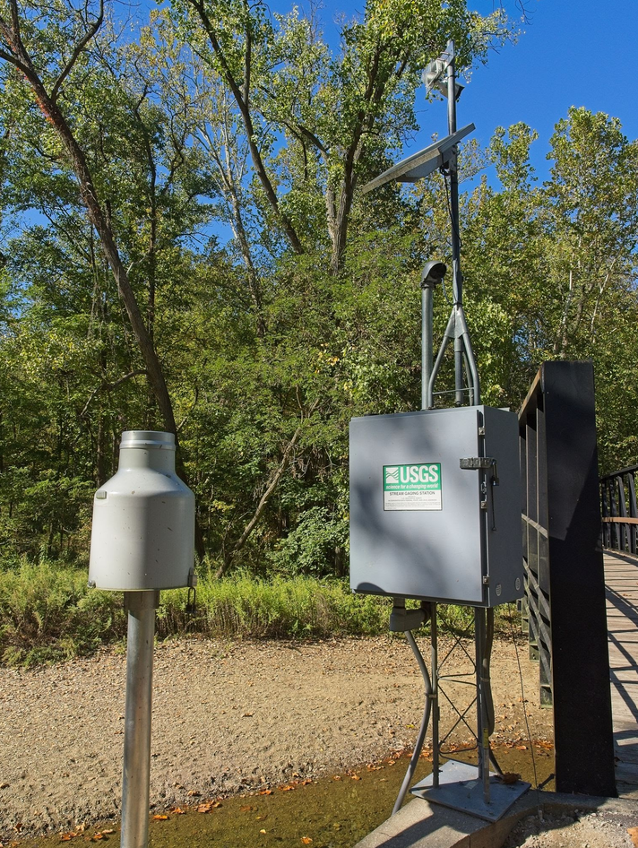
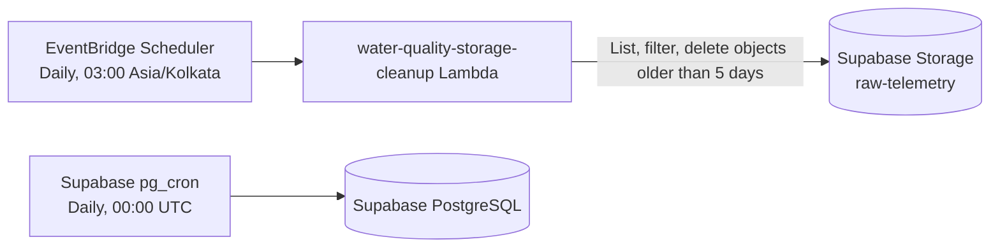
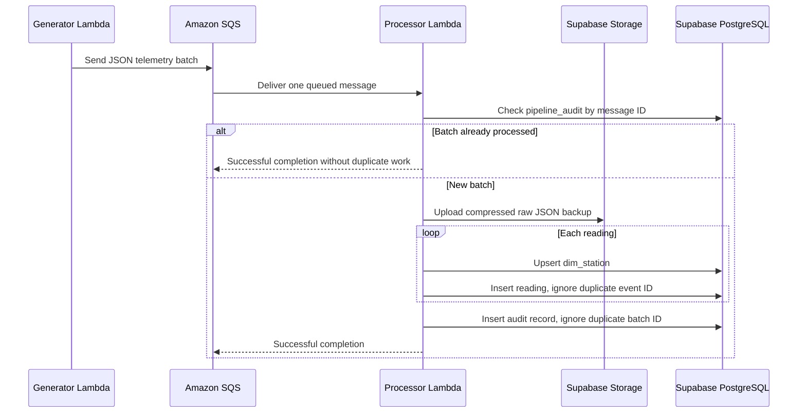
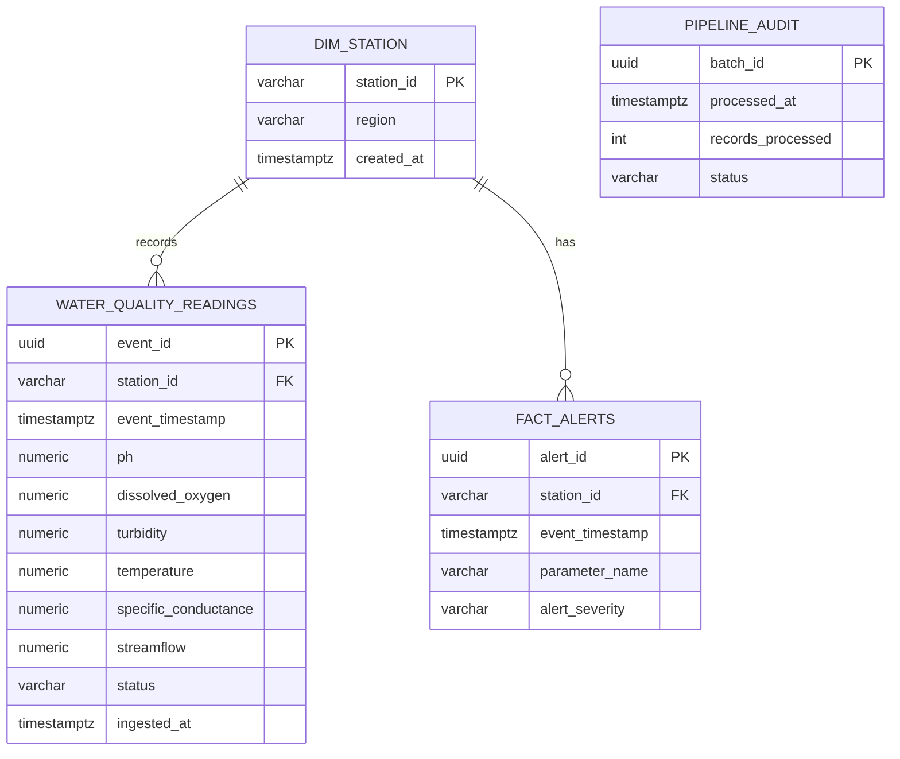

# Water Quality ETL Pipeline



An AWS serverless ETL pipeline that generates simulated water-quality telemetry,
buffers it through Amazon SQS, persists it to Supabase PostgreSQL, and retains
compressed raw payloads in Supabase Storage. The pipeline includes independent
five-day retention policies for both database data and raw Storage backups.

## What has been built

- A telemetry generator Lambda that creates water-quality measurements for 25
  stations over a five-minute collection window (125 readings per message).
- An SQS-backed processor Lambda that validates and stores the readings.
- A normalized Supabase PostgreSQL schema for stations, readings, alerts, and
  processing audits.
- Gzip-compressed raw-payload backups in the `raw-telemetry` Supabase Storage
  bucket.
- SQS retry protection through batch auditing and conflict-safe inserts.
- A scheduled Storage cleanup Lambda that removes raw objects older than five
  days.
- A `pg_cron` SQL job that removes database readings and audit entries older
  than five days.

## Architecture




## Message processing flow



## Repository layout

| Path | Purpose |
|---|---|
| `src/generator.py` | Creates simulated telemetry and publishes a batch to SQS. |
| `src/processor.py` | SQS consumer that uploads raw backups and writes normalized data to Supabase. |
| `src/storage_cleanup.py` | Separate scheduled Lambda that removes Storage objects older than five days. |
| `sql/schema.sql` | Database tables and indexes. |
| `sql/rolling-cron-job.sql` | Supabase `pg_cron` job for database retention. |
| `deploy_processor.bat` | Builds and deploys the processor Lambda. |
| `cleanup_env.example.json` | Safe template for the cleanup Lambda environment. |
| `requirements.txt` | Pinned Python runtime and development dependencies. |

## Data model



## Configuration

The processor Lambda requires the following environment variables:

| Variable | Description |
|---|---|
| `SUPABASE_DB_URI` | Supabase **transaction pooler** URI, using port `6543`. |
| `SUPABASE_URL` | Supabase project URL. |
| `SUPABASE_SERVICE_KEY` | Server-side key used to write raw backups to Storage. |

The cleanup Lambda requires only `SUPABASE_URL` and
`SUPABASE_SERVICE_KEY`. Create `cleanup_env.json` from
`cleanup_env.example.json`; it is intentionally ignored by Git.

The generator requires `SQS_QUEUE_URL`. When running locally, it also uses
`AWS_REGION` if set.

> Never commit `.env`, `update_env.json`, `env_pooler.json`, or
> `cleanup_env.json`. They contain runtime secrets and are excluded by
> `.gitignore`.

## Initial database setup

Run [`sql/schema.sql`](sql/schema.sql) in the Supabase SQL Editor before
processing messages. It creates the dimension, fact, and audit tables along
with indexes for time-series and station queries.

## Running locally

Create and activate a virtual environment, then install dependencies:

```cmd
python -m venv venv
venv\Scripts\activate
pip install -r requirements.txt
```

To generate and send a test batch, make sure `.env` contains a valid
`SQS_QUEUE_URL`, then run:

```cmd
python src\generator.py
```

To run the Storage cleanup locally, make sure `.env` contains `SUPABASE_URL`
and `SUPABASE_SERVICE_KEY`:

```cmd
python -c "from dotenv import load_dotenv; load_dotenv(); from src.storage_cleanup import lambda_handler; print(lambda_handler({}, None))"
```

This cleanup command permanently deletes raw Storage objects older than five
days.

## Processor deployment

`deploy_processor.bat` packages the compatible database driver set,
uploads the ZIP to `water-quality-processor`, waits for the update, and applies
the environment configuration from `update_env.json`.

```cmd
deploy_processor.bat
```

The deployed processor uses these operational settings:

| Setting | Value | Reason |
|---|---:|---|
| Lambda timeout | 120 seconds | A 125-reading message performs many database writes. |
| Lambda memory | 256 MB | Provides additional CPU/network capacity while retaining a small footprint. |
| SQS batch size | 1 | Avoids processing up to ten 125-reading messages in one invocation. |
| SQS visibility timeout | 720 seconds | Prevents concurrent redelivery while an invocation is still running. |

## Five-day retention

### Raw Storage retention

`src/storage_cleanup.py` is deployed as the
`water-quality-storage-cleanup` Lambda. Its EventBridge Scheduler schedule,
`water-quality-storage-cleanup-daily`, runs at 03:00 in `Asia/Kolkata`.

The handler paginates through `raw-telemetry`, compares each object’s
`created_at` time to a five-day UTC cutoff, and deletes eligible paths in
batches of at most 1,000.

### Database retention

Run [`sql/rolling-cron-job.sql`](sql/rolling-cron-job.sql) once in the
Supabase SQL Editor to enable its `pg_cron` schedule. It runs daily at midnight
UTC and deletes:

- `water_quality_readings` where `event_timestamp` is older than five days.
- `pipeline_audit` entries where `processed_at` is older than five days.

Storage retention and database retention are intentionally independent: one
removes raw backups, while the other removes relational telemetry and audit
history.

## Reliability and idempotency

Amazon SQS provides at-least-once delivery. The processor therefore handles
duplicates in two layers:

1. It checks `pipeline_audit` using the SQS message ID before processing.
2. It uses `ON CONFLICT DO NOTHING` for both `event_id` and `batch_id` inserts.

This prevents duplicate deliveries from failing the function when a prior
attempt already committed the data.

Failed messages are retried by SQS and then routed to
`water-quality-dlq` after the configured maximum receive count. Redrive DLQ
messages only after confirming healthy processor logs.

## Verification and operations

Tail the processor logs:

```cmd
aws logs tail /aws/lambda/water-quality-processor --region ap-south-1 --since 10m
```

Check recent ingested readings in Supabase:

```sql
select count(*) as readings, max(ingested_at) as latest_ingestion
from water_quality_readings;
```

Check cleanup Lambda logs:

```cmd
aws logs tail /aws/lambda/water-quality-storage-cleanup --region ap-south-1 --since 10m
```

## Security notes

- Use the Supabase transaction-pooler endpoint copied directly from the
  Supabase Connect dialog. Do not construct the pooler region or host manually.
- URL-encode reserved characters in database passwords when placing them in a
  connection URI.
- Rotate a password or service key immediately if it is exposed in a terminal,
  commit, or chat transcript.
- The current processor disables TLS certificate and hostname verification for
  the Supabase pooler. Replace this with CA validation before a production
  deployment.
- The cleanup function has no need for the database URI; keep its environment
  limited to the Storage URL and service key.

## Change log

### 2026-11-09

- Added the SQS-to-Supabase processor Lambda and deployment script.
- Pinned `pg8000==1.30.5` with `scramp==1.4.4` to avoid an incompatible
  channel-binding API change.
- Switched database access to the Supabase transaction pooler configuration.
- Added duplicate-safe reading and audit inserts for SQS retry behavior.
- Increased the processor timeout and reduced SQS processing to one message per
  invocation.
- Added the daily Storage cleanup Lambda with five-day raw-data retention.
- Added the `pg_cron` SQL job for five-day relational-data retention.
- Added secret and generated-artifact exclusions to `.gitignore`.
