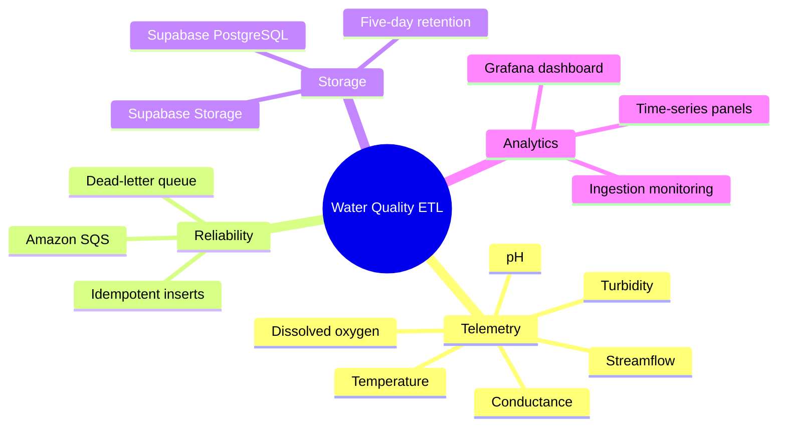
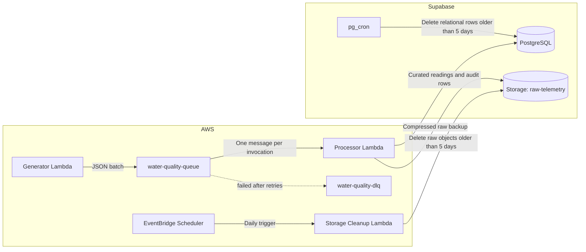
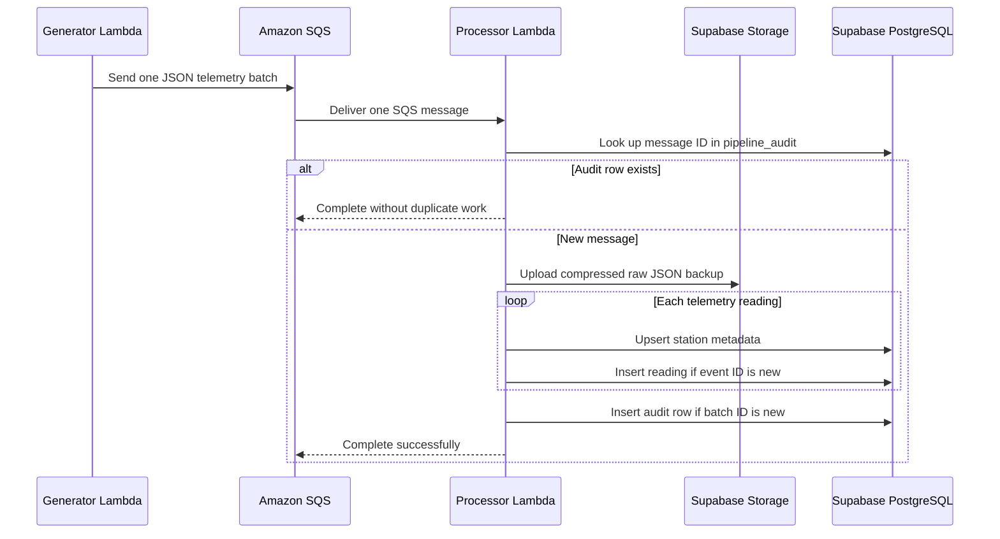
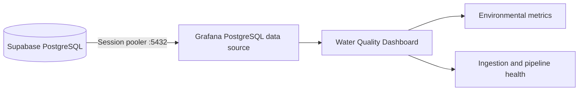
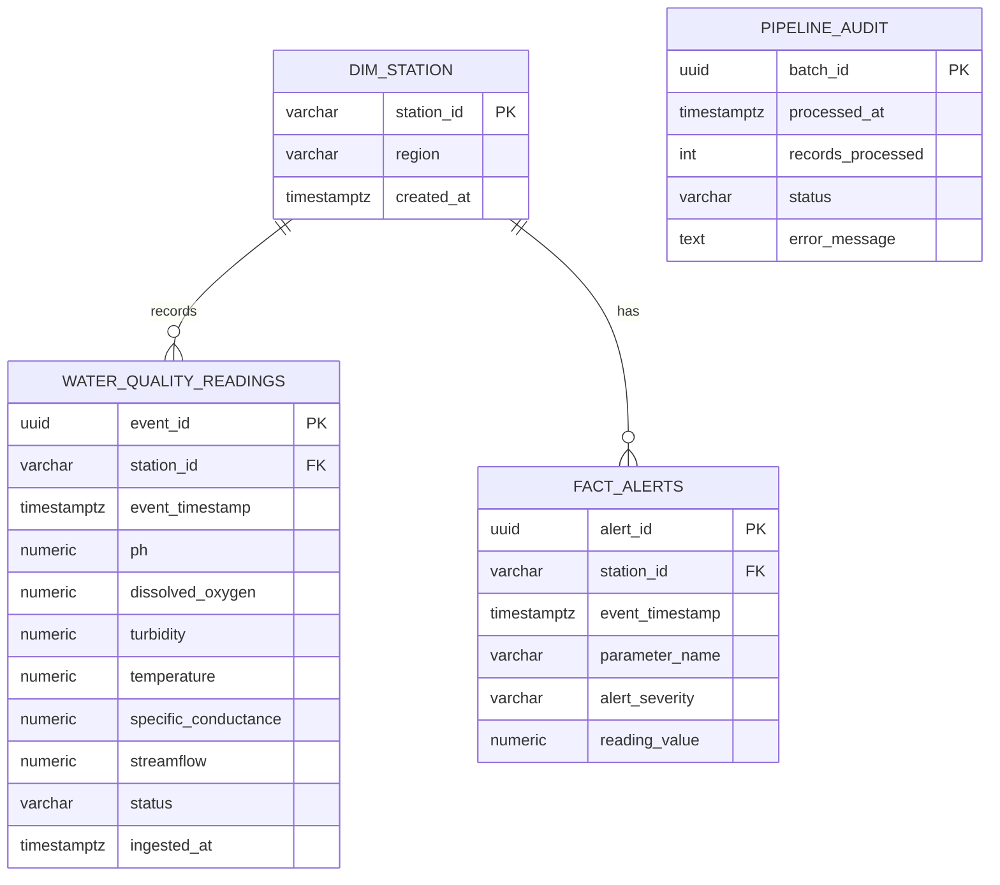
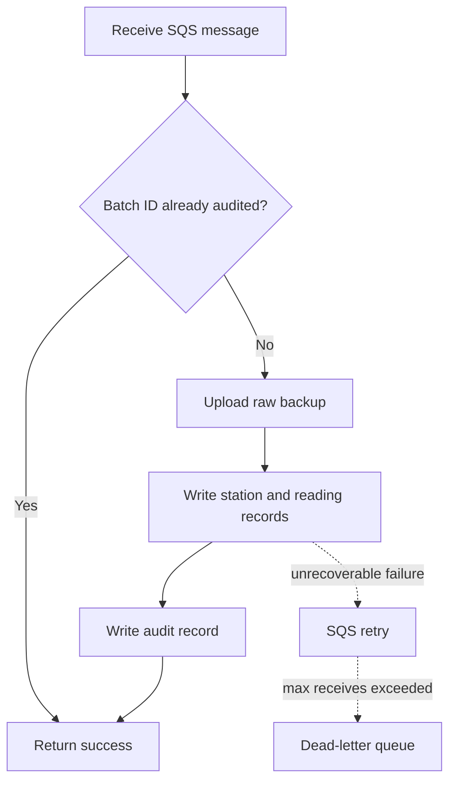
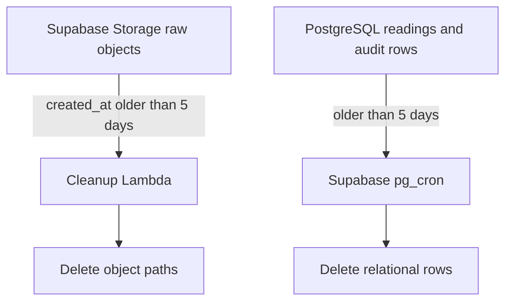
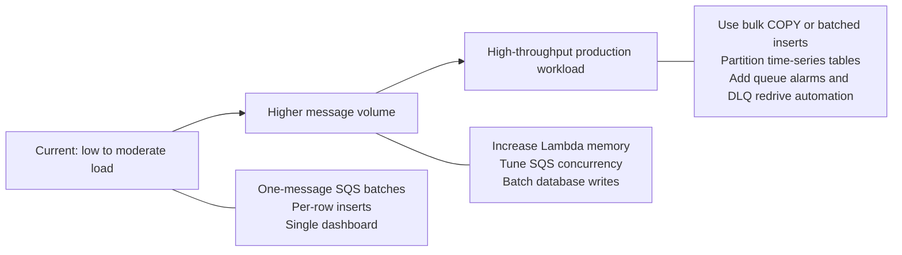

# End-to-End Water Quality ETL Pipeline and BI


An event-driven, serverless data pipeline for simulated water-quality telemetry.
The project generates sensor readings, reliably ingests them through Amazon SQS,
stores curated data in Supabase PostgreSQL, preserves compressed raw payloads in
Supabase Storage, and exposes operational and environmental insights through
Grafana.

## Contents

- [Project overview](#project-overview)
- [Architecture](#architecture)
- [End-to-end data flow](#end-to-end-data-flow)
- [Pipeline components](#pipeline-components)
- [Technologies used, in plain language](#technologies-used-in-plain-language)
- [Data model](#data-model)
- [Reliability and retention](#reliability-and-retention)
- [Grafana dashboards](#grafana-dashboards)
- [Local development and deployment](#local-development-and-deployment)
- [Operations and security](#operations-and-security)
- [Change log](#change-log)
- [Scalability and scenarios](#scalability-and-scenarios)

## Project overview

### Goals

- Simulate time-series telemetry from distributed water-quality stations.
- Decouple data generation from processing with a durable queue.
- Store raw and curated data separately for traceability and analytics.
- Make message redelivery safe through idempotent writes.
- Retain only the most recent five days of raw and relational data.
- Visualize environmental readings and ingestion health in Grafana.

### What the pipeline produces

Each generated record includes a station identifier, region, event timestamp,
status, and measurements for pH, dissolved oxygen, turbidity, temperature,
specific conductance, and streamflow. A normal generator run produces 25
stations across five collection minutes, resulting in 125 readings in one SQS
message.



## Architecture




## End-to-end data flow

### 1. Generate telemetry

`src/generator.py` simulates realistic water-quality values and intentionally
introduces anomalies and missing measurements for downstream testing. It sends
the JSON array to Amazon SQS rather than invoking the processor directly.


### 2. Buffer and decouple with SQS

Amazon SQS absorbs bursts, separates producers from consumers, and retries
failed processing. The processor event-source mapping is configured with a
batch size of one so each invocation handles one 125-reading payload.


### 3. Process and persist

`src/processor.py` connects to the Supabase transaction pooler, checks the
batch audit table, uploads a gzip raw-data backup, upserts station metadata,
inserts readings, and records the completed batch. The function uses a 120
second timeout and 256 MB memory allocation.



### 4. Serve analytics

Grafana connects through the Supabase **session pooler** on port `5432`. The
processor uses port `6543` because it is a short-lived serverless client;
Grafana uses the session pooler because it maintains database connections for
interactive dashboards.



## Pipeline components

| Component | Responsibility | Key behavior |
|---|---|---|
| Generator Lambda | Produces simulated sensor batches | Generates 125 readings per run and sends one message to SQS. |
| SQS queue | Buffers telemetry and retries failures | Batch size 1, visibility timeout 720 seconds, DLQ after configured retries. |
| Processor Lambda | Performs the ETL workflow | Uploads raw backup, writes curated rows, and records audit status. |
| Supabase PostgreSQL | Stores query-ready telemetry | Normalized schema with time-series indexes. |
| Supabase Storage | Stores immutable raw backups | Each SQS body is gzip-compressed and stored in `raw-telemetry`. |
| Cleanup Lambda | Enforces raw-object retention | Daily scheduled deletion of objects older than five days. |
| Supabase `pg_cron` | Enforces relational-data retention | Daily deletion of expired readings and audit rows. |
| Grafana | Visualizes data and operational behavior | PostgreSQL data source and public dashboard. |

## Technologies used, in plain language

This section explains the platform without assuming data-engineering experience.

| Technology | What it is | Why this project uses it |
|---|---|---|
| **Python** | A general-purpose programming language that is popular for automation and data work. | It powers the generator, processor, and cleanup functions. |
| **AWS Lambda** | Serverless compute: AWS runs small pieces of code only when they are needed. | The project does not need to run or maintain application servers continuously. |
| **Amazon SQS** | A managed message queue. Think of it as a durable waiting line between two systems. | It lets telemetry generation continue even if processing is temporarily slow or unavailable. |
| **Dead-letter queue (DLQ)** | A separate queue for messages that repeatedly fail processing. | It prevents one bad message from blocking the normal queue and preserves it for investigation. |
| **Supabase PostgreSQL** | A managed relational database based on PostgreSQL. Relational databases store structured records in linked tables. | It holds query-ready station, reading, and audit data for analytics and dashboards. |
| **Supabase Storage** | Managed object storage for files rather than database rows. | It preserves the original telemetry payload as a compressed backup before transformation. |
| **EventBridge Scheduler** | AWS's managed clock for running a task on a timetable. | It invokes the Storage cleanup Lambda once each day. |
| **Supabase `pg_cron`** | A PostgreSQL extension that schedules SQL commands inside the database. | It removes expired readings and audit records without requiring another application server. |
| **Grafana** | A visualization and dashboard platform for time-series and operational data. | It turns stored measurements into charts, tables, and ingestion-health panels. |
| **Gzip** | A file-compression format that reduces storage size. | Raw JSON messages are compressed before being saved to Supabase Storage. |
| **pg8000** | A pure-Python PostgreSQL database driver. A driver is the library an application uses to speak to a database. | The processor uses it to write telemetry to Supabase PostgreSQL from Lambda. |

> **About Parquet:** Parquet is a column-oriented file format commonly used for
> large-scale analytics because it is efficient for reading selected columns.
> This project does **not** currently use Parquet; raw payloads are stored as
> gzip-compressed JSON. Parquet would be a sensible future option if long-term
> historical data were exported to a data lake for large analytical workloads.

## Data model



### Supabase tables

#### `dim_station`

Station dimension data is inserted with `ON CONFLICT DO NOTHING`, allowing
many readings from the same station without duplicate metadata rows.


#### `water_quality_readings`

The fact table contains one row per telemetry event. `event_id` is the primary
key and makes repeated SQS deliveries harmless.


#### `pipeline_audit`

The audit table records completed SQS batches using the SQS message ID as the
primary key. It provides observability and prevents already-completed batches
from being processed again.


## Reliability and retention

### Idempotency and retry behavior

SQS uses at-least-once delivery. A message can be delivered more than once,
particularly after a timeout or transient downstream failure. The processor
handles this safely in three layers:

1. It checks `pipeline_audit` before beginning work.
2. It ignores duplicate `event_id` values when inserting readings.
3. It ignores duplicate `batch_id` values when recording audit completion.



### Five-day retention policy

Raw and relational data are retained independently so each storage layer can
be managed according to its purpose.



#### Raw Storage retention

`src/storage_cleanup.py` is deployed as
`water-quality-storage-cleanup`. EventBridge Scheduler invokes it every day at
03:00 in `Asia/Kolkata`. The handler paginates through the `raw-telemetry`
bucket, filters by `created_at`, and deletes eligible paths in batches of up to
1,000.


#### Relational-data retention

Run [`sql/rolling-cron-job.sql`](sql/rolling-cron-job.sql) once in the Supabase
SQL Editor. It enables `pg_cron` and schedules daily cleanup at midnight UTC:

- `water_quality_readings` are removed when `event_timestamp` is older than
  five days.
- `pipeline_audit` records are removed when `processed_at` is older than five
  days.

> The supplied SQL intentionally retains `dim_station` and `fact_alerts`.
> Adjust the SQL if those tables require the same retention policy.

## Grafana dashboards


The Grafana dashboard turns the curated PostgreSQL table into a live view of
water quality and pipeline activity. It is intended for both environmental
monitoring and operational validation after each ingestion run.

### Data-source configuration

Use the Supabase **shared session pooler** in Grafana:

| Field | Value |
|---|---|
| Host URL | `aws-0-ap-southeast-1.pooler.supabase.com:5432` |
| Database | `postgres` |
| Username | `postgres.<project-ref>` |
| Password | Current Supabase database password in plain text, not a URI. |
| TLS/SSL mode | `require` |

Use the exact Session pooler host and username copied from the Supabase Connect
dialog for the project. Do not use the processor Lambda transaction-pooler
configuration (`:6543`) in Grafana.

### Useful panels and queries

**pH over time by station**

```sql
SELECT
  event_timestamp AS "time",
  ph AS "value",
  station_id AS "metric"
FROM water_quality_readings
WHERE $__timeFilter(event_timestamp)
ORDER BY 1;
```

**Readings ingested per minute**

```sql
SELECT
  date_trunc('minute', ingested_at) AS "time",
  count(*) AS "value"
FROM water_quality_readings
WHERE $__timeFilter(ingested_at)
GROUP BY 1
ORDER BY 1;
```

**Latest station status**

```sql
SELECT DISTINCT ON (station_id)
  station_id,
  status,
  event_timestamp,
  ph,
  turbidity,
  dissolved_oxygen
FROM water_quality_readings
ORDER BY station_id, event_timestamp DESC;
```

### Public dashboard

[Open the Water Quality Grafana Dashboard](https://sereneiris1223.grafana.net/public-dashboards/f9fb0a33a28f43ac878b03267ebce7d3)

## Local development and deployment

### Prerequisites

- Python 3.12
- AWS CLI configured for `ap-south-1`
- A Supabase project with the schema applied
- A Grafana Cloud account or self-hosted Grafana instance

### Install dependencies

```cmd
python -m venv venv
venv\Scripts\activate
pip install -r requirements.txt
```

### Environment variables

| Variable | Used by | Purpose |
|---|---|---|
| `SQS_QUEUE_URL` | Generator | Queue destination for telemetry batches. |
| `AWS_REGION` | Generator | AWS region for the SQS client. |
| `SUPABASE_DB_URI` | Processor | Transaction-pooler connection URI. |
| `SUPABASE_URL` | Processor and cleanup | Supabase project URL. |
| `SUPABASE_SERVICE_KEY` | Processor and cleanup | Server-side Storage API credential. |

Copy `cleanup_env.example.json` to `cleanup_env.json` before deploying the
cleanup Lambda. Keep all live environment files out of version control.

### Generate a test batch

```cmd
python src\generator.py
```

### Deploy the processor

```cmd
deploy_processor.bat
```

The deployment script builds the dependency package, publishes the processor
ZIP, waits for Lambda to finish updating, and applies `update_env.json`.

### Verify pipeline health

```cmd
aws logs tail /aws/lambda/water-quality-processor --region ap-south-1 --since 10m
```

```sql
SELECT
  count(*) AS readings,
  max(ingested_at) AS latest_ingestion
FROM water_quality_readings;
```

## Operations and security

- Store credentials only in ignored environment files or a managed secret
  store. Rotate a password or service key immediately if it is exposed.
- Copy the Supabase pooler hostname from the Connect dialog; do not construct
  it from a cloud region name.
- URL-encode reserved characters only when placing a password in a database
  URI. Grafana's password field expects the plain password.
- The cleanup Lambda deliberately receives no database URI because it only
  manages Supabase Storage.
- Failed processor messages land in `water-quality-dlq` after the configured
  SQS retry threshold. Redrive them only after the processor is healthy.
- The processor currently disables TLS certificate and hostname verification
  for the pooler. Replace that temporary workaround with CA validation before
  a production deployment.

## Scalability and scenarios

### Scaling path



| Scenario | Expected behavior | Recommended evolution |
|---|---|---|
| Normal station telemetry | One 125-reading batch is processed in a single Lambda invocation. | Keep SQS batch size at one and monitor duration. |
| Short traffic burst | SQS stores backlog while Lambda scales consumers. | Increase event-source maximum concurrency only after validating Supabase connection limits. |
| Duplicate SQS delivery | Existing event and batch keys are ignored. | Retain the current idempotent constraints and audit table. |
| Slow database writes | Lambda duration increases because inserts are per row. | Move to `executemany`, multi-row inserts, or PostgreSQL `COPY`. |
| Millions of readings | Retention deletes become more expensive and dashboards scan more data. | Partition by event time, retain rollups, and add summary tables or materialized views. |
| Dashboard growth | More users open concurrent Grafana panels. | Create a dedicated read-only Grafana role and tune session-pooler connection limits. |
| Long-term analytics | Five-day operational retention is insufficient. | Export raw files to low-cost object storage and build an analytical warehouse or lakehouse layer. |

The current architecture is intentionally optimized for a small operational
telemetry workload. SQS provides the buffer for burst absorption, while the
database and Storage layers remain independently scalable. The next major
performance improvement is replacing per-row database calls with bulk writes;
that reduces latency, lowers Lambda cost, and enables higher SQS concurrency.
